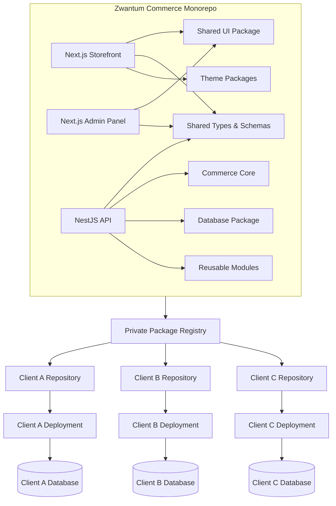

# Zwantum Commerce Engine
## Technical Architecture & Implementation Blueprint

**Status:** Final Architecture Proposal  
**Team:** 2 Developers  
**Purpose:** Build a reusable, modular, white-label e-commerce platform that can power multiple businesses with minimal repeated development.

> **Build once. Reuse everywhere. Configure per client. Deploy independently.**

---

# 1. Executive Summary

Zwantum will build a reusable e-commerce engine that allows the engineering team to develop core functionality once and reuse it across multiple client projects.

Each client will have:

- A separate GitHub repository
- A separate frontend deployment
- A separate backend deployment
- A separate PostgreSQL database
- Separate environment variables and credentials
- A client-specific storefront theme
- Client-specific installed and enabled modules
- Independent deployment and release cycles

However, the underlying functionality will be developed and maintained centrally by the Zwantum engineering team.

The platform will support multiple business categories, including:

- Fashion and clothing
- Food and grocery
- Books and publishing
- Beauty and wellness
- Electronics
- General retail

The architecture will prioritize performance, security, maintainability, and simplicity for a two-developer team.

---

# 2. Final Technology Stack

| Layer | Technology | Purpose |
|---|---|---|
| Language | TypeScript | Common language across applications |
| Storefront | Next.js | Customer-facing e-commerce website |
| Admin Panel | Next.js | Store management dashboard |
| Backend | NestJS | Modular commerce API |
| Runtime | Node.js | Persistent backend runtime |
| UI | React | Component-based interfaces |
| Styling | Tailwind CSS | Styling and design system |
| UI Components | shadcn/ui | Accessible reusable components |
| Database | PostgreSQL | Relational commerce data |
| ORM | Prisma | Database access and migrations |
| Validation | Zod | Runtime validation and shared schemas |
| Package Manager | pnpm | Dependency and workspace management |
| Monorepo Tool | Turborepo | Build orchestration and caching |
| State Management | Zustand | Lightweight client-side state |
| Data Fetching | TanStack Query | Client-side API data management |
| Testing | Vitest | Unit and integration testing |
| E2E Testing | Playwright | Browser-based application testing |
| Package Registry | GitHub Packages | Private reusable packages |
| API Hosting | Persistent Node.js hosting | Long-running backend service |
| Frontend Hosting | Vercel or suitable alternative | Next.js deployment |
| Media Storage | S3-compatible object storage | Product images and media |
| CDN | Cloudflare or hosting provider CDN | Asset delivery and caching |

## Why this stack?

It provides:

- A consistent TypeScript development experience.
- Strong frontend and backend separation.
- Reusable packages across client projects.
- A structured backend architecture.
- SEO-friendly storefront rendering.
- A practical foundation for scaling.
- Manageability for a two-person engineering team.

---

# 3. High-Level System Architecture



**Important:** The monorepo is the central development environment. Client applications are deployed independently.

---

# 4. Monorepo Structure

The central repository will contain the applications, reusable packages, themes, and modules.

```text
zwantum-commerce/
│
├── apps/
│   │
│   ├── storefront/
│   │   ├── app/
│   │   ├── components/
│   │   ├── hooks/
│   │   ├── services/
│   │   ├── lib/
│   │   ├── styles/
│   │   └── public/
│   │
│   ├── admin/
│   │   ├── app/
│   │   ├── components/
│   │   ├── hooks/
│   │   ├── services/
│   │   ├── lib/
│   │   └── styles/
│   │
│   └── api/
│       └── src/
│           ├── modules/
│           ├── common/
│           ├── config/
│           ├── database/
│           ├── integrations/
│           ├── jobs/
│           └── main.ts
│
├── packages/
│   │
│   ├── ui/
│   │
│   ├── shared-types/
│   │
│   ├── validation/
│   │
│   ├── database/
│   │
│   ├── auth/
│   │
│   ├── commerce-core/
│   │
│   ├── storefront-core/
│   │
│   ├── theme-contract/
│   │
│   ├── theme-minimal/
│   │
│   ├── theme-luxury/
│   │
│   ├── theme-fashion/
│   │
│   ├── payment-contract/
│   │
│   ├── payment-razorpay/
│   │
│   ├── shipping-contract/
│   │
│   ├── shipping-shiprocket/
│   │
│   ├── shipping-manual/
│   │
│   └── chatbot/
│
├── tooling/
│
├── docs/
│   ├── ARCHITECTURE.md
│   ├── MODULE_DEVELOPMENT.md
│   ├── THEME_DEVELOPMENT.md
│   ├── CLIENT_DEPLOYMENT.md
│   └── SECURITY.md
│
├── package.json
├── pnpm-workspace.yaml
├── turbo.json
├── tsconfig.base.json
└── README.md
```

## Important package strategy

Do not create an NPM package for every small feature or component.

Start with a few well-defined packages. Extract a feature into its own package when:

- It is genuinely reusable.
- It has a stable interface.
- It can be tested independently.
- It can be versioned independently.
- Its separation improves maintainability.

Avoid premature abstraction.

---

# 5. Application Architecture

## 5.1 Storefront — Next.js

The storefront is responsible for the customer experience.

Features:

- Homepage
- Product listings
- Product details
- Categories and collections
- Search and filters
- Product variants
- Cart
- Checkout
- Customer authentication
- Customer profile
- Order history
- Order tracking
- SEO metadata
- Responsive layouts

### Rendering strategy

| Page | Rendering approach |
|---|---|
| Homepage | Static or revalidated rendering |
| Product listing | Static/revalidated where appropriate |
| Product details | Static generation or revalidation |
| Cart | Client-side interactions |
| Checkout | Server-validated operations |
| Customer account | Authenticated, private rendering |
| Order tracking | Authenticated API requests |

**Goal:** Fast page loading without unnecessary server-side computation on every request.

## 5.2 Admin Panel — Next.js

The admin panel is responsible for managing the store.

Features:

- Product management
- Category management
- Inventory
- Orders
- Customers
- Discounts
- Shipping settings
- Payment settings
- Store branding
- Theme customization
- Module configuration
- Analytics
- Staff permissions

The admin panel communicates with the NestJS backend.

## 5.3 Backend — NestJS

The backend handles all business logic.

Responsibilities:

- Authentication
- Authorization
- Products
- Categories
- Inventory
- Pricing
- Cart
- Checkout
- Orders
- Payments
- Shipping
- Customers
- Discounts
- Themes
- Module registry
- Notifications
- Audit logs

The backend will initially be a **modular monolith**.

This means all backend modules run inside one NestJS application while maintaining clear boundaries.

We will not start with microservices.

---

# 6. Backend Folder Structure

```text
apps/api/src/
│
├── main.ts
│
├── app.module.ts
│
├── config/
│   ├── env.schema.ts
│   └── configuration.ts
│
├── common/
│   ├── decorators/
│   ├── guards/
│   ├── interceptors/
│   ├── filters/
│   ├── pipes/
│   └── utilities/
│
├── modules/
│   │
│   ├── auth/
│   │
│   ├── users/
│   │
│   ├── staff/
│   │
│   ├── stores/
│   │
│   ├── catalog/
│   │   ├── products/
│   │   ├── categories/
│   │   └── variants/
│   │
│   ├── inventory/
│   │
│   ├── pricing/
│   │
│   ├── cart/
│   │
│   ├── checkout/
│   │
│   ├── orders/
│   │
│   ├── payments/
│   │   ├── payment.module.ts
│   │   ├── payment.service.ts
│   │   └── providers/
│   │
│   ├── shipping/
│   │   ├── shipping.module.ts
│   │   ├── shipping.service.ts
│   │   └── providers/
│   │
│   ├── discounts/
│   │
│   ├── customers/
│   │
│   ├── themes/
│   │
│   ├── modules-registry/
│   │
│   ├── media/
│   │
│   ├── notifications/
│   │
│   ├── analytics/
│   │
│   └── audit/
│
└── health/
```

### Backend rules

- Controllers should remain thin.
- Business logic belongs in services/domain logic.
- Each module should have a clear responsibility.
- Avoid circular dependencies.
- Use transactions for critical operations.
- Validate every external input.
- Enforce authorization on every protected endpoint.
- Do not expose provider credentials to the frontend.

---

# 7. Database Architecture

## PostgreSQL + Prisma

Every client will have a separate PostgreSQL database.

Example:

```text
Client A → PostgreSQL Database A
Client B → PostgreSQL Database B
Client C → PostgreSQL Database C
```

## Why separate databases?

- Better data isolation.
- Easier client-specific backups.
- Independent migrations.
- Independent maintenance.
- Easier client offboarding.
- Reduced risk of cross-client data leakage.

## Core entities

```text
Store
User
Staff
Role
Permission

Customer
CustomerAddress

Product
ProductVariant
ProductCategory
ProductMedia

Inventory
InventoryMovement

Cart
CartItem

Order
OrderItem

Payment
Refund

Shipment
ShipmentTracking

Discount
Coupon

StoreSettings
ThemeSettings

ModuleConfiguration
AuditLog
```

## Database rules

- Use relational constraints.
- Use transactions for checkout and order processing.
- Store money as integer minor units (e.g., paise) with a currency code.
- Never use floating-point values for financial calculations.
- Use indexes based on real query patterns.
- Store timestamps in UTC.
- Use Prisma migrations.
- Never modify the production database schema manually.
- Never seed production with dummy customer data.

---

# 8. Theme Architecture

Themes are complete storefront designs, not merely different color palettes.

Each theme has its own:

- Homepage composition
- Header and navigation
- Product card design
- Product listing layout
- Product detail layout
- Typography
- Footer
- Section layouts
- Responsive design
- Theme-specific customization options

## Example theme catalog

```text
@zwantum/theme-minimal
@zwantum/theme-luxury
@zwantum/theme-fashion
@zwantum/theme-traditional
@zwantum/theme-marketplace
```

## Theme lifecycle

1. Zwantum developers build themes centrally.
2. Themes are added to the theme gallery.
3. The client previews available themes.
4. The client approves a theme.
5. The developer installs the selected theme package.
6. Branding and settings are configured.
7. The application is tested and deployed.

## Admin customization

The client admin can edit:

- Store name
- Logo
- Brand colors
- Font family from approved options
- Navbar color
- Navbar style
- Button appearance
- Footer content
- Hero banners
- Product card preferences
- Supported homepage sections

## Theme configuration example

```ts
export interface StoreThemeConfig {
  themeId: string;

  branding: {
    storeName: string;
    logoUrl?: string;
    faviconUrl?: string;
  };

  colors: {
    primary: string;
    secondary: string;
    accent: string;
    background: string;
    text: string;
    navbarBackground: string;
    navbarText: string;
  };

  typography: {
    headingFont: string;
    bodyFont: string;
  };

  layout: {
    headerVariant: string;
    footerVariant: string;
    productCardVariant: string;
  };
}
```

This configuration should be validated before saving.

**Important:** Normal theme customization should not require a new code deployment whenever possible.

---

# 9. Module Architecture

Modules are reusable features that can be installed into any client application.

## Example modules

| Category | Modules |
|---|---|
| Payments | Razorpay, Cashfree, Stripe |
| Shipping | Shiprocket, manual shipping, other providers |
| AI | Chatbot, voice AI |
| Marketing | Coupons, referrals, loyalty |
| Analytics | Store analytics |
| Recommendations | Product recommendations |
| Support | FAQ, support tickets |
| Search | Advanced search and filtering |

## Module lifecycle

Every module should have these states:

| State | Meaning |
|---|---|
| Authorized | Zwantum allows the client to use it |
| Installed | Module package exists in the client's codebase |
| Configured | Required settings are available |
| Enabled | Client admin has activated it |
| Healthy | Module is functioning correctly |

These states must not be treated as interchangeable.

## Example module manifest

```ts
export interface CommerceModuleManifest {
  id: string;
  name: string;
  version: string;
  description: string;

  dependencies?: string[];

  capabilities: string[];

  configSchemaVersion: number;
}
```

## Module installation workflow

When a new client requires a chatbot:

1. Developer installs the chatbot package.
2. Developer configures the module for the client.
3. Developer configures its permissions and required credentials.
4. Developer tests the integration.
5. Developer pushes the code to the client's repository.
6. Developer deploys the application.
7. Admin can enable or disable the chatbot if authorized.

When another client requires the same chatbot, the developer installs the same package and configures a different brand context.

**No chatbot rewriting is required.**

---

# 10. Module Permissions and Super Admin

Zwantum should maintain internal control over which client can use which modules.

## Super Admin responsibilities

- Authorize modules for clients.
- View installed module versions.
- Manage client module entitlements.
- Revoke access when necessary.
- Manage subscription-based capabilities.
- View module health information.
- Manage platform-level configurations.

## Client Admin responsibilities

- Enable or disable authorized modules.
- Configure module settings.
- Configure supported integrations.
- Select an installed shipping provider.
- Manage theme settings.
- Manage store branding.

## Developer responsibilities

- Build modules.
- Publish reusable packages.
- Install modules in client repositories.
- Configure integrations.
- Review security.
- Test and deploy.

## Important rule

The client admin cannot install a module that is not:

1. Authorized by Zwantum.
2. Installed in that client's application.
3. Properly configured.

---

# 11. Payment Module Architecture

Payment providers should be independent of the core checkout logic.

## Example package structure

```text
packages/
│
├── payment-contract/
│
├── payment-razorpay/
│
├── payment-cashfree/
│
└── payment-stripe/
```

## Payment interface

```ts
export interface PaymentProvider {
  createPayment(
    input: CreatePaymentInput
  ): Promise<PaymentResult>;

  verifyWebhook(
    input: WebhookInput
  ): Promise<WebhookVerificationResult>;

  refund?(
    input: RefundInput
  ): Promise<RefundResult>;
}
```

## Example

The client initially uses Razorpay.

Later, the developer installs Cashfree.

The client admin can choose Cashfree from the payment settings if:

- Cashfree is installed.
- Cashfree is authorized.
- Credentials are configured.
- Required checks pass.

The core checkout system remains unchanged.

## Security requirements

- Verify payment webhooks on the server.
- Never trust frontend payment success.
- Implement idempotency.
- Store payment state separately from order state.
- Keep credentials server-side.
- Never store raw card information unless explicitly required and appropriately compliant.

---

# 12. Shipping Module Architecture

## Example packages

```text
packages/
│
├── shipping-contract/
│
├── shipping-shiprocket/
│
├── shipping-manual/
│
└── shipping-other-provider/
```

## Shipping interface

```ts
export interface ShippingProvider {
  createShipment(
    input: CreateShipmentInput
  ): Promise<ShipmentResult>;

  getTracking(
    input: TrackingInput
  ): Promise<TrackingResult>;

  cancelShipment?(
    input: CancelShipmentInput
  ): Promise<CancelShipmentResult>;
}
```

## Example scenario

A client initially uses Shiprocket.

Later, the client wants manual shipping.

The developer installs the manual shipping module and deploys it.

The admin can then select:

```text
Shipping Provider:

( ) Shiprocket
( ) Manual Shipping
```

The admin does not need to write code.

If both modules are already installed and configured, switching between them can be a configuration change.

---

# 13. Chatbot Module Architecture

The chatbot should be developed once and reused across different clients.

## Package

```text
@zwantum/chatbot
```

## Reusable capabilities

- Product discovery
- Product recommendations
- FAQ responses
- Store policy answers
- Order tracking
- Support-ticket creation
- Optional voice interaction

## Client-specific context

Each client has its own:

- Brand name
- Brand tone
- Assistant identity
- FAQs
- Store policies
- Product catalog
- Knowledge base
- Shipping and return policies
- Enabled chatbot capabilities

## Example

```ts
export interface ChatbotConfig {
  enabled: boolean;

  assistantName: string;

  brandTone: string;

  capabilities: {
    productSearch: boolean;
    recommendations: boolean;
    orderTracking: boolean;
    faq: boolean;
    supportTickets: boolean;
  };

  knowledgeBaseId?: string;
}
```

## Client isolation

- Separate knowledge bases per client.
- Separate conversation history.
- Separate vector-store namespaces or databases.
- No cross-client retrieval.
- No cross-client order access.
- Validate customer identity before providing order information.
- Never expose API keys to the browser.

---

# 14. Private NPM Package Strategy

Reusable modules and themes should be distributed through private packages.

## Example package names

```text
@zwantum/commerce-core

@zwantum/theme-minimal

@zwantum/theme-luxury

@zwantum/payment-razorpay

@zwantum/payment-cashfree

@zwantum/shipping-shiprocket

@zwantum/shipping-manual

@zwantum/chatbot
```

## Publishing workflow

1. Developer implements the module in the central monorepo.
2. Unit and integration tests are added.
3. Code review and security checks are performed.
4. Package is versioned.
5. Package is published to GitHub Packages.
6. Developer installs it in the required client repository.
7. Client repository pins the package version.
8. Client is tested and deployed.

## Versioning

Use semantic versioning:

```text
1.0.0  Initial stable release

1.0.1  Bug fix

1.1.0  Backward-compatible feature

2.0.0  Breaking change
```

Never automatically update every client to the latest version.

Each client should upgrade deliberately after testing.

---

# 15. Client Repository Structure

Every client repository should contain its application and client-specific configuration.

```text
mithila-naturals/
│
├── apps/
│   ├── storefront/
│   ├── admin/
│   └── api/
│
├── packages/
│   └── client-config/
│
├── prisma/
│
├── tests/
│
├── docs/
│
├── .env.example
│
├── package.json
│
├── pnpm-workspace.yaml
│
└── README.md
```

## Client configuration

```text
packages/client-config/
│
├── store.config.ts
│
├── theme.config.ts
│
├── modules.config.ts
│
└── business.config.ts
```

These files contain client-specific non-secret configuration.

Sensitive credentials must remain in environment variables or secret managers.

---

# 16. Performance Architecture

The primary requirement is a fast application with predictable response times.

**We are not choosing serverless as the default backend architecture.**

## Recommended hosting model

| Application | Hosting |
|---|---|
| Storefront | Vercel or suitable Next.js hosting |
| Admin | Vercel or suitable Next.js hosting |
| NestJS API | Persistent Node.js server |
| Database | Managed PostgreSQL |
| Media | Object storage |
| Static assets | CDN |
| Background jobs | Persistent worker when required |

## Why persistent backend?

A persistent Node.js service avoids the typical per-function cold-start pattern of serverless APIs.

However, persistent hosting does not automatically guarantee performance. Database latency, queries, caching, rendering, and network overhead still matter.

## Performance practices

- Static rendering for stable pages.
- Revalidation for product and category pages where appropriate.
- Server rendering only when required.
- CDN for static assets.
- Image optimization.
- Database indexing.
- Pagination.
- Optimized SQL queries.
- Reuse database connections correctly.
- Avoid unnecessary API requests.
- Avoid unnecessary client-side JavaScript.
- Use caching with proper invalidation.
- Monitor API latency and Core Web Vitals.

## Redis

Redis is not mandatory for the first version.

Introduce it when there is a demonstrated need for:

- Caching
- Rate limiting
- Distributed locks
- Background job coordination
- Frequently accessed data

## Background jobs

For tasks such as:

- Sending emails
- Generating reports
- Processing webhooks
- AI processing
- Inventory synchronization

Use a background worker when these tasks become too expensive or unreliable to perform in request-response flows.

---

# 17. Deployment Architecture

Each client receives a separate deployment.

## Example

```text
Mithila Naturals

shop.mithilanaturals.com
        │
        ▼
Next.js Storefront
        │
        ▼
NestJS API
        │
        ▼
Mithila Naturals PostgreSQL
```

```text
Client XYZ

shop.clientxyz.com
        │
        ▼
Next.js Storefront
        │
        ▼
NestJS API
        │
        ▼
Client XYZ PostgreSQL
```

## Deployment isolation

Each client has:

- Separate GitHub repository.
- Separate hosting projects.
- Separate API deployment.
- Separate database.
- Separate secrets.
- Separate domains.
- Separate storage configuration.
- Separate release lifecycle.

---

# 18. Manual Client Deployment Workflow

The deployment process will intentionally remain manual and reviewed during the initial phase.

## Step-by-step

### Step 1: Create the repository

Create a client repository using the approved Zwantum template.

### Step 2: Select a theme

Install the client's approved theme package.

### Step 3: Install modules

Install required packages:

```bash
pnpm add @zwantum/payment-razorpay

pnpm add @zwantum/shipping-shiprocket

pnpm add @zwantum/chatbot
```

Install only the modules required by that client.

### Step 4: Configure branding

Set:

- Store name
- Logo
- Colors
- Fonts
- Navbar
- Theme settings

### Step 5: Configure modules

Set provider credentials and required settings securely.

### Step 6: Database setup

Create the client's PostgreSQL database.

Configure Prisma and run migrations.

### Step 7: Environment configuration

Inject environment variables through the hosting provider's secret manager.

### Step 8: Security review

Check:

- Authentication
- Authorization
- Webhook verification
- Module permissions
- Client data isolation
- Environment variables
- Dependency vulnerabilities

### Step 9: Testing

Run:

- Unit tests
- Integration tests
- E2E tests
- Build checks

### Step 10: Deployment

Deploy the frontend, admin and backend separately.

### Step 11: Verification

Verify:

- Product listing
- Cart
- Checkout
- Payments
- Webhooks
- Shipping
- Email notifications
- Admin permissions
- Logs
- Health checks

### Step 12: Rollback readiness

Document the previous stable version and rollback procedure.

---

# 19. Environment Variables

Example `.env.example`:

```env
NODE_ENV=production

DATABASE_URL=

API_BASE_URL=
NEXT_PUBLIC_API_BASE_URL=

AUTH_SECRET=

PAYMENT_PROVIDER=
PAYMENT_SECRET_KEY=
PAYMENT_WEBHOOK_SECRET=

SHIPPING_PROVIDER=
SHIPPING_API_KEY=

OBJECT_STORAGE_ENDPOINT=
OBJECT_STORAGE_ACCESS_KEY=
OBJECT_STORAGE_SECRET_KEY=
OBJECT_STORAGE_BUCKET=
```

## Rules

- Never commit real `.env` files.
- Never expose server secrets through `NEXT_PUBLIC_*`.
- Validate environment variables at application startup.
- Keep separate development, staging and production credentials.
- Use secure secret management.
- Rotate exposed credentials immediately.

---

# 20. Security Architecture

Security must be integrated from the beginning.

## Authentication and authorization

Roles may include:

```text
Zwantum Super Admin

Store Admin

Store Staff

Customer
```

Every protected API endpoint must verify permissions on the server.

## Data security

- Separate databases per client.
- Separate API credentials.
- Separate storage permissions.
- Separate AI knowledge bases.
- Validate client/store identity server-side.
- Never trust client-supplied roles or prices.
- Test cross-client data isolation.

## Payments

- Verify provider webhooks.
- Use idempotency.
- Maintain payment and order state machines.
- Never trust frontend payment status.
- Do not store raw card data unnecessarily.

## Application security

- Input validation.
- Rate limiting.
- Secure session handling.
- CSRF protection where applicable.
- XSS protection.
- SQL injection prevention.
- Dependency auditing.
- Secret scanning.
- Audit logs for administrative actions.

## Package security

- Review all packages before publishing.
- Pin versions.
- Maintain changelogs.
- Avoid arbitrary runtime code execution.
- Do not allow clients to install untrusted plugins.
- Test breaking changes against a staging client.

---

# 21. Testing Strategy

## Unit tests

Test:

- Pricing calculations
- Discount calculations
- Inventory logic
- Validation
- Business rules
- Module configurations

## Integration tests

Test:

- PostgreSQL interactions
- Prisma queries
- Payment provider adapters
- Shipping provider adapters
- Module behavior
- Webhook handling

## E2E tests

Test the complete flow:

```text
Customer visits storefront
        ↓
Browses products
        ↓
Adds product to cart
        ↓
Checks out
        ↓
Completes payment
        ↓
Order is created
        ↓
Admin sees the order
        ↓
Shipping is processed
        ↓
Customer tracks order
```

## Security tests

Test:

- Unauthorized admin access
- Customer access to other customers' orders
- Cross-client data access
- Webhook spoofing
- Module permission bypass
- Sensitive configuration exposure

## Performance tests

Test:

- Product listing latency
- Product detail loading
- API response times
- Checkout latency
- Database performance
- Concurrent traffic

---

# 22. CI/CD Workflow

Every pull request should run:

```text
Pull Request
    │
    ├── TypeScript Check
    │
    ├── Lint
    │
    ├── Unit Tests
    │
    ├── Integration Tests
    │
    ├── Dependency Scan
    │
    ├── Secret Scan
    │
    └── Build Validation
            │
            ▼
       Code Review
            │
            ▼
      Merge to Main
            │
            ▼
     Version Package
            │
            ▼
    Publish Package
            │
            ▼
    Update Client Repo
            │
            ▼
   Staging Deployment
            │
            ▼
   Production Deployment
```

Production deployment should require approval.

---

# 23. Two-Developer Workflow

## Suggested ownership

| Developer | Primary responsibility |
|---|---|
| Developer A | Storefront, themes, shared UI, admin panel |
| Developer B | NestJS API, database, commerce core, integrations |
| Both | Architecture, security, code reviews, testing, releases |

## Working rules

- Small pull requests.
- Shared TypeScript contracts.
- Clear package boundaries.
- Code reviews for sensitive changes.
- Document module interfaces.
- Avoid duplicate implementations.
- Maintain a staging client.
- Keep security and tests part of the definition of done.

---

# 24. Implementation Roadmap

## Phase 1 — Foundation

- Setup pnpm and Turborepo.
- Configure TypeScript.
- Configure linting and formatting.
- Setup Next.js storefront.
- Setup Next.js admin.
- Setup NestJS API.
- Configure PostgreSQL.
- Setup Prisma.
- Setup authentication.
- Setup CI.

## Phase 2 — Core Commerce

- Products
- Categories
- Variants
- Inventory
- Customers
- Cart
- Checkout
- Orders
- Admin dashboard

## Phase 3 — First Theme

- Build one complete production-quality theme.
- Define theme configuration.
- Implement branding customization.
- Optimize SEO and performance.
- Test mobile responsiveness.

## Phase 4 — First Integrations

- Implement Razorpay.
- Implement one shipping provider.
- Define provider contracts.
- Add webhook verification.
- Add integration tests.

## Phase 5 — Client Template

- Create the client repository template.
- Configure separate databases.
- Configure hosting.
- Document deployment.
- Implement rollback procedures.

## Phase 6 — Module System

- Create module registry.
- Define module manifest.
- Implement module authorization.
- Implement module settings.
- Publish reusable private packages.
- Test installation in a client repo.

## Phase 7 — Expansion

- Additional themes.
- Additional payment providers.
- Additional shipping providers.
- Chatbot.
- Voice AI.
- Analytics.
- Recommendations.
- Performance optimization based on measurements.

---

# 25. Risks and Mitigations

| Risk | Mitigation |
|---|---|
| Too many packages | Start with a small package set |
| Code duplication across clients | Shared versioned packages |
| Client-specific customizations become difficult to maintain | Use configuration and extension points |
| Breaking package updates | Semantic versioning and controlled upgrades |
| Theme complexity | Prebuilt themes and controlled customization |
| Unsafe plugin system | Trusted packages and security reviews |
| Cross-client data leakage | Separate databases and isolation testing |
| Payment inconsistencies | Webhook verification and idempotency |
| Poor performance | Profiling, caching and database optimization |
| Two-person team overload | Modular monolith and phased development |
| Deployment failures | CI, staging and rollback |

---

# 26. Final Architecture Decision

The final proposed architecture is:

```text
ZWANTUM COMMERCE ENGINE

Development:
    Monorepo
    pnpm
    Turborepo

Applications:
    Next.js Storefront
    Next.js Admin
    NestJS API

Backend:
    Modular Monolith
    Node.js Persistent Runtime

Database:
    PostgreSQL
    Prisma

Reusable Components:
    Private NPM Packages
    Theme Packages
    Payment Modules
    Shipping Modules
    Chatbot Modules

Client Delivery:
    Separate GitHub Repository
    Separate Frontend Deployment
    Separate Backend Deployment
    Separate PostgreSQL Database
    Separate Environment Variables

Customization:
    Prebuilt Themes
    Runtime Branding
    Configurable Navbar
    Authorized Module Toggles
    Client-Specific Settings

Operations:
    Manual Reviewed Deployment
    Security Checks
    CI/CD
    Versioned Packages
    Controlled Upgrades
```

---

# 27. Final Guiding Principle

Zwantum should not rebuild e-commerce applications from scratch for every client.

Instead, it should maintain a reusable commerce ecosystem where every client receives a carefully configured combination of:

- A prebuilt storefront theme.
- Core commerce functionality.
- Reusable payment and shipping modules.
- Optional AI and chatbot modules.
- Client-specific branding and settings.
- Independent hosting and infrastructure.

**The real value is not simply writing less code. It is building a system where new client projects require configuration, integration, testing, and deployment instead of rebuilding the entire application.**

For a two-developer team, the most important decision is to keep the first version small, modular, secure, and well-tested.

Build one complete client store first. Validate the architecture. Then gradually extract reusable packages, add themes, and expand the module ecosystem.

That is the most practical path to scaling Zwantum's engineering capacity without sacrificing performance or maintainability.
