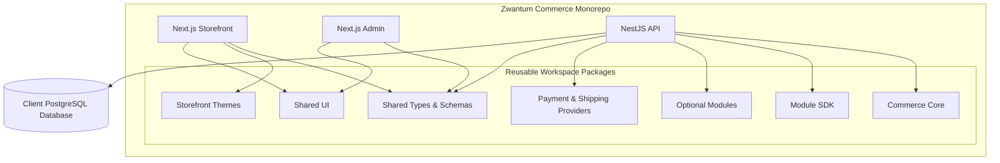

# Zwantum Commerce Engine

## Technical Architecture & Implementation Blueprint

**Status:** Architecture & Development Blueprint  
**Team:** 2 Developers  
**Product:** Custom-built, modular, white-label e-commerce infrastructure

> **Build once. Reuse everywhere. Configure per client. Deploy independently.**

---

# 1. Executive Summary

Zwantum Commerce Engine is a custom-built, modular, white-label e-commerce platform designed to power multiple independent businesses through a shared, centrally maintained codebase.

The goal is to eliminate repetitive development across client projects while maintaining flexibility, security, performance, and independent deployment capabilities.

The platform will be developed from scratch using modern web technologies. Existing commerce platforms such as Medusa and Vendure may be used as architectural references, but they will not be used as the foundation or runtime dependencies of the engine.

## Core objectives

- Build a reusable commerce infrastructure.
- Support multiple businesses and industries.
- Maintain one central codebase.
- Develop reusable themes, modules, and integrations.
- Provide a configurable Admin Panel.
- Support independently deployed client stores.
- Keep client data, credentials, and infrastructure isolated.
- Enable controlled upgrades without maintaining separate code forks.
- Build a scalable architecture without premature microservices.

## Supported business categories

- Fashion and clothing
- Food and grocery
- Books and publishing
- Beauty and wellness
- Electronics
- General retail

---

# 2. Architecture Decisions

| Area                 | Decision                                |
| -------------------- | --------------------------------------- |
| Repository           | Monorepo                                |
| Backend architecture | Modular Monolith                        |
| Backend framework    | NestJS                                  |
| Backend runtime      | Persistent Node.js                      |
| Frontend             | Next.js                                 |
| Database             | PostgreSQL                              |
| ORM                  | Prisma                                  |
| Package manager      | pnpm                                    |
| Monorepo tooling     | Turborepo                               |
| Shared development   | Workspace packages                      |
| Module distribution  | Private npm packages when appropriate   |
| Client architecture  | Independent deployments                 |
| Client data          | Separate PostgreSQL database per client |
| Infrastructure       | Persistent hosting + managed services   |
| Initial deployment   | Manual and reviewed                     |
| Future provisioning  | Gradually automated                     |

## Understanding the architecture

**Monorepo:** All applications and reusable packages are maintained in one Git repository.

**Modular Monolith:** The backend is one deployable NestJS application organized into independent, well-defined modules.

**Independent Deployments:** Each client receives its own deployment of the required applications, backend, configuration, and database while the source code remains centrally maintained.

These three concepts work together; they are not competing architectures.

---

# 3. Technology Stack

| Layer            | Technology                         | Purpose                               |
| ---------------- | ---------------------------------- | ------------------------------------- |
| Language         | TypeScript                         | Shared language across applications   |
| Storefront       | Next.js                            | Customer-facing website               |
| Admin Panel      | Next.js                            | Store management dashboard            |
| Backend          | NestJS                             | Commerce API                          |
| Runtime          | Node.js                            | Persistent backend runtime            |
| UI               | React                              | Component-based interface             |
| Styling          | Tailwind CSS                       | Styling and design system             |
| UI Components    | shadcn/ui                          | Accessible reusable components        |
| Database         | PostgreSQL                         | Relational data storage               |
| ORM              | Prisma                             | Data access and migrations            |
| Validation       | Zod                                | Runtime validation and shared schemas |
| Package Manager  | pnpm                               | Dependency and workspace management   |
| Monorepo         | Turborepo                          | Build orchestration and caching       |
| State Management | Zustand                            | Client-side state                     |
| Data Fetching    | TanStack Query                     | API data management                   |
| Unit Testing     | Vitest                             | Unit and integration tests            |
| E2E Testing      | Playwright                         | Browser-based testing                 |
| Package Registry | GitHub Packages                    | Private package distribution          |
| API Hosting      | Railway / VPS / Cloud VM           | Persistent NestJS deployment          |
| Frontend Hosting | Vercel or equivalent               | Next.js deployment                    |
| Media Storage    | S3-compatible storage / Cloudinary | Product media                         |
| CDN              | Cloudflare or hosting provider     | Asset delivery                        |

---

# 4. High-Level System Architecture



## Important distinction

`apps/api` is the actual backend application and server.

`packages/commerce-core`, `packages/module-sdk`, and other packages are reusable code that the API integrates.

**Packages are not independently hosted backend servers.**

---

# 5. Monorepo Structure

The following is the proposed central development repository.

```text
zwantum-commerce/
│
├── apps/
│   ├── api/                         # Main NestJS backend
│   │   └── src/
│   │       ├── modules/              # Core backend modules
│   │       ├── common/
│   │       ├── config/
│   │       ├── integrations/
│   │       ├── jobs/
│   │       ├── app.module.ts
│   │       └── main.ts
│   │
│   ├── admin/                       # Next.js Admin Panel
│   │   ├── app/
│   │   ├── components/
│   │   ├── hooks/
│   │   ├── services/
│   │   └── lib/
│   │
│   └── storefront/                   # Next.js Storefront
│       ├── app/
│       ├── components/
│       ├── hooks/
│       ├── services/
│       ├── lib/
│       └── public/
│
├── packages/
│   ├── commerce-core/                 # Core business logic
│   ├── module-sdk/                    # Module development SDK
│   ├── shared-types/                  # Shared TypeScript types
│   ├── validation/                    # Shared validation schemas
│   ├── database/                       # Shared database utilities
│   ├── auth/                           # Shared auth utilities
│   ├── ui/                             # Shared UI components
│   ├── storefront-core/                 # Storefront abstractions
│   │
│   ├── theme-contract/                  # Theme interface
│   ├── themes/
│   │   ├── minimal/
│   │   ├── luxury/
│   │   └── fashion/
│   │
│   ├── payment-contract/                # Payment provider interface
│   ├── payments/
│   │   ├── razorpay/
│   │   └── cashfree/
│   │
│   ├── shipping-contract/               # Shipping provider interface
│   ├── shipping/
│   │   ├── shiprocket/
│   │   └── manual/
│   │
│   └── modules/                         # Reusable optional modules
│       ├── wishlist/
│       ├── reviews/
│       ├── loyalty/
│       ├── chatbot/
│       └── analytics/
│
├── tooling/
│
├── docs/
│   ├── ARCHITECTURE.md
│   ├── MODULE_DEVELOPMENT.md
│   ├── THEME_DEVELOPMENT.md
│   ├── CLIENT_DEPLOYMENT.md
│   └── SECURITY.md
│
├── package.json
├── pnpm-workspace.yaml
├── turbo.json
├── tsconfig.base.json
└── README.md
```

## Workspace configuration

`pnpm-workspace.yaml`:

```yaml
packages:
  - 'apps/*'
  - 'packages/*'
  - 'packages/themes/*'
  - 'packages/payments/*'
  - 'packages/shipping/*'
  - 'packages/modules/*'
```

## Package development principle

Not every feature needs to become a published npm package.

Initially, develop and integrate packages directly through the pnpm workspace. Publish only packages that are genuinely reusable, stable, independently testable, and suitable for versioned distribution.

---

# 6. Application Architecture

## 6.1 Storefront — Next.js

The storefront provides the complete customer-facing shopping experience.

### Core features

- Homepage
- Product listing
- Product details
- Categories and collections
- Search and filtering
- Product variants
- Shopping cart
- Checkout
- Customer authentication
- Customer profile
- Order history
- Order tracking
- SEO metadata
- Responsive layouts

### Rendering strategy

| Page             | Approach                             |
| ---------------- | ------------------------------------ |
| Homepage         | Static or revalidated rendering      |
| Product listing  | Static/revalidated where appropriate |
| Product details  | Static generation or revalidation    |
| Cart             | Client-side interactions             |
| Checkout         | Server-validated operations          |
| Customer account | Authenticated rendering              |
| Order tracking   | Authenticated API requests           |

## 6.2 Admin Panel — Next.js

The Admin Panel provides a reusable management interface for all client stores.

### Core features

- Dashboard
- Product management
- Category management
- Inventory management
- Order management
- Customer management
- Discounts and coupons
- Shipping settings
- Payment settings
- Store branding
- Theme customization
- Module configuration
- Analytics
- Staff accounts and permissions

The Admin Panel should use a shared component system and configurable navigation, but access to features must always be enforced by the backend.

## 6.3 Backend — NestJS

The backend is the main commerce API and business logic layer.

### Responsibilities

- Authentication and authorization
- Products and categories
- Product variants
- Inventory
- Pricing
- Cart and checkout
- Orders
- Payments
- Shipping
- Customers
- Discounts
- Store configuration
- Module registration
- Notifications
- Audit logs
- Background processing

The backend will initially remain a **Modular Monolith**.

All core modules run within one NestJS application and communicate through defined interfaces and module boundaries.

Microservices will only be considered when actual operational or scaling requirements justify them.

---

# 7. Backend Module Structure

```text
apps/api/src/
│
├── main.ts
├── app.module.ts
│
├── config/
│   ├── env.schema.ts
│   └── configuration.ts
│
├── common/
│   ├── decorators/
│   ├── guards/
│   ├── interceptors/
│   ├── filters/
│   ├── pipes/
│   └── utilities/
│
├── modules/
│   ├── auth/
│   ├── users/
│   ├── staff/
│   ├── stores/
│   │
│   ├── catalog/
│   │   ├── products/
│   │   ├── categories/
│   │   └── variants/
│   │
│   ├── inventory/
│   ├── pricing/
│   ├── cart/
│   ├── checkout/
│   ├── orders/
│   ├── customers/
│   ├── discounts/
│   ├── payments/
│   ├── shipping/
│   ├── themes/
│   ├── module-registry/
│   ├── media/
│   ├── notifications/
│   ├── analytics/
│   └── audit/
│
└── health/
```

## Backend development rules

- Keep controllers thin.
- Put business logic inside services and domain logic.
- Define clear module boundaries.
- Avoid circular dependencies.
- Use transactions for critical operations.
- Validate all external input.
- Enforce permissions on every protected endpoint.
- Never expose provider credentials to the frontend.
- Keep module dependencies explicit.

---

# 8. Database Architecture

## PostgreSQL + Prisma

Every client will have a separate PostgreSQL database.

```text
Client A → PostgreSQL Database A
Client B → PostgreSQL Database B
Client C → PostgreSQL Database C
```

## Why separate databases?

- Stronger client data isolation
- Independent backups and restoration
- Independent database migrations
- Easier client offboarding
- Reduced risk of cross-client data leakage
- Client-specific maintenance and recovery

## Core entities

```text
Store
User
Staff
Role
Permission

Customer
CustomerAddress

Product
ProductVariant
ProductCategory
ProductMedia

Inventory
InventoryMovement

Cart
CartItem

Order
OrderItem

Payment
Refund

Shipment
ShipmentTracking

Discount
Coupon

StoreSettings
ThemeSettings

ModuleConfiguration
AuditLog
```

## Database rules

- Use relational constraints.
- Use transactions for checkout and order processing.
- Store money as integer minor units, such as paise, with a currency code.
- Never use floating-point numbers for financial calculations.
- Index based on actual query patterns.
- Store timestamps in UTC.
- Use Prisma migrations.
- Never modify production schemas manually.
- Never seed production with dummy customer or order data.

---

# 9. Theme Architecture

Themes are complete storefront design systems, not merely color palettes.

Each theme defines:

- Homepage composition
- Header and navigation
- Product card design
- Product listing layout
- Product detail layout
- Typography
- Footer
- Section layouts
- Responsive behavior
- Supported customization options

## Example theme catalog

```text
@zwantum/theme-minimal
@zwantum/theme-luxury
@zwantum/theme-fashion
@zwantum/theme-traditional
@zwantum/theme-marketplace
```

## Theme lifecycle

1. Developers build themes centrally in the monorepo.
2. Themes are tested against the shared theme contract.
3. A theme is added to the available theme catalog.
4. The client selects or approves a theme.
5. The selected theme is integrated into the client's storefront.
6. Branding and settings are configured.
7. The storefront is tested and deployed.

## Admin customization

The client admin can customize supported settings:

- Store name
- Logo and favicon
- Brand colors
- Approved font options
- Navbar color and style
- Button appearance
- Footer content
- Hero banners
- Product card variants
- Supported homepage sections

## Theme configuration

```ts
export interface StoreThemeConfig {
  themeId: string;

  branding: {
    storeName: string;
    logoUrl?: string;
    faviconUrl?: string;
  };

  colors: {
    primary: string;
    secondary: string;
    accent: string;
    background: string;
    text: string;
  };

  typography: {
    headingFont: string;
    bodyFont: string;
  };

  layout: {
    headerVariant: string;
    footerVariant: string;
    productCardVariant: string;
  };
}
```

Theme configurations must be validated before saving.

**Important:** Normal branding and theme configuration should not require a new code deployment whenever possible.

---

# 10. Module Architecture

Modules are reusable capabilities that extend the core commerce engine.

## Module categories

| Category            | Examples                     |
| ------------------- | ---------------------------- |
| Marketing           | Wishlist, loyalty, referrals |
| Customer experience | Reviews, ratings             |
| AI                  | Chatbot, voice AI            |
| Analytics           | Store analytics              |
| Recommendations     | Product recommendations      |
| Support             | FAQ, support tickets         |
| Payments            | Razorpay, Cashfree           |
| Shipping            | Shiprocket, manual shipping  |

## Three types of modules

### A. Core modules

Essential commerce capabilities maintained within the main backend.

Examples: Products, Orders, Inventory, Cart, Checkout.

These are not independently deployed services.

### B. Optional feature modules

Reusable features that can be integrated into the API and Admin Panel.

Examples: Wishlist, Reviews, Loyalty, Chatbot.

### C. Provider modules

Adapters that integrate external services through standardized contracts.

Examples: Razorpay, Cashfree, Shiprocket.

---

# 11. Module SDK

The Module SDK will provide a standard interface for developing optional modules.

It should define the supported module lifecycle and integration points, including:

- Backend module registration
- Module metadata and manifest
- Admin navigation registration
- Admin routes and UI integration
- Permissions
- Settings schema
- Database migrations
- Lifecycle hooks
- Dependency declarations
- Compatibility requirements
- Module health checks

## Example module manifest

```ts
export interface CommerceModuleManifest {
  id: string;
  name: string;
  version: string;
  description: string;

  dependencies?: string[];

  capabilities: string[];

  configSchemaVersion: number;

  compatibility: {
    commerceEngine: string;
    moduleSdk: string;
  };
}
```

## NestJS integration

NestJS Dynamic Modules can be used as the backend registration mechanism.

The SDK should wrap and standardize this functionality rather than reinventing the NestJS module system.

Example:

```ts
@Module({})
export class WishlistModule {
  static register(options: WishlistOptions): DynamicModule {
    return {
      module: WishlistModule,
      providers: [
        {
          provide: WISHLIST_OPTIONS,
          useValue: options,
        },
      ],
      exports: [WishlistService],
    };
  }
}
```

The actual SDK API will be finalized after implementing and testing the first optional module.

---

# 12. Module Development Workflow

**All modules will initially be developed inside the central monorepo.**

We will not need to publish a package every time we make a change during development.

## Phase 1 — Develop the module

Create the module inside:

```text
packages/modules/wishlist/
```

Example structure:

```text
wishlist/
│
├── src/
│   ├── backend/
│   │   ├── wishlist.module.ts
│   │   ├── wishlist.service.ts
│   │   ├── wishlist.controller.ts
│   │   └── wishlist.repository.ts
│   │
│   ├── admin/
│   │   ├── pages/
│   │   ├── components/
│   │   └── routes.ts
│   │
│   ├── migrations/
│   ├── permissions/
│   ├── module.config.ts
│   └── index.ts
│
├── tests/
├ ── unit/
├ ── integration/
│
├── package.json
├── tsconfig.json
└── README.md
```

The exact structure can evolve with the Module SDK.

## Phase 2 — Integrate through the workspace

During development, the API can consume the module using:

```json
{
  "dependencies": {
    "@zwantum/module-wishlist": "workspace:*"
  }
}
```

The module is available directly from the monorepo.

No private registry publishing is required.

## Phase 3 — Develop and test locally

Run the applications and module through the workspace:

```bash
pnpm install

pnpm dev
```

Test:

- Backend endpoints
- Business logic
- Database interactions
- Module settings
- Permissions
- Admin UI
- Error handling
- Integration with existing commerce functionality

## Phase 4 — Build and verify

Before preparing a release:

```bash
pnpm --filter @zwantum/module-wishlist build

pnpm --filter @zwantum/module-wishlist test
```

Also verify:

- TypeScript compilation
- Linting
- Integration tests
- Compatibility with the Module SDK
- Compatibility with the supported commerce engine version
- Database migration behavior
- Security review

## Phase 5 — Package locally

Create a package archive:

```bash
pnpm --filter @zwantum/module-wishlist pack
```

This produces a `.tgz` archive.

Install that archive into a separate test application to verify that the module works outside the monorepo workspace.

```bash
pnpm add ./zwantum-module-wishlist-1.0.0.tgz
```

This step is important because workspace development can hide missing dependencies or incorrect package exports.

## Phase 6 — Publish the package

After successful verification, publish the package to the private GitHub Packages registry.

```bash
pnpm publish
```

The package should have:

- A unique package name
- A valid version
- Correct build output
- Correct exports
- Required dependencies
- README documentation
- Changelog
- Compatibility declaration

## Phase 7 — Install in a client application

For a client that requires Wishlist:

```bash
pnpm add @zwantum/module-wishlist@1.0.0
```

Then:

1. Register the module in the backend.
2. Integrate its Admin Panel navigation and UI.
3. Apply its database migrations.
4. Configure permissions.
5. Configure the module.
6. Test the module in the client environment.
7. Deploy the client application.

**The package is integrated into the application build. It is not a separate server that needs hosting.**

---

# 13. Private Package Registry

GitHub Packages will be the initial private registry.

## Example package names

```text
@zwantum/commerce-core

@zwantum/module-sdk

@zwantum/module-wishlist
@zwantum/module-reviews
@zwantum/module-loyalty
@zwantum/module-chatbot

@zwantum/payment-razorpay
@zwantum/payment-cashfree

@zwantum/shipping-shiprocket
@zwantum/shipping-manual

@zwantum/theme-minimal
@zwantum/theme-luxury
```

## Publishing rules

- Use semantic versioning.
- Publish only verified packages.
- Maintain changelogs.
- Pin package versions in deployments.
- Never automatically update every client to the latest version.
- Test upgrades in staging before production.
- Avoid breaking changes without a major version increment.

## Semantic versioning

```text
1.0.0  Initial stable release

1.0.1  Bug fix

1.1.0  Backward-compatible feature

2.0.0  Breaking change
```

---

# 14. Module Installation and Lifecycle

A module's state should be tracked explicitly.

| State      | Meaning                                        |
| ---------- | ---------------------------------------------- |
| Authorized | Zwantum permits the client to use the module   |
| Available  | Compatible package version is available        |
| Installed  | Package is integrated into the application     |
| Configured | Required settings and credentials are provided |
| Enabled    | Client admin has activated the module          |
| Healthy    | Module is operating correctly                  |

These states are not interchangeable.

## Installation flow

```text
Module Available
      ↓
Zwantu​m Authorizes Client
      ↓
Developer Installs Package
      ↓
Backend Registration
      ↓
Database Migrations
      ↓
Permissions & Configuration
      ↓
Integration Testing
      ↓
Deployment
      ↓
Client Admin Enables Module
      ↓
Module Active
```

## Super Admin responsibilities

- Authorize modules for clients.
- Manage module entitlements.
- View installed versions.
- Manage subscription-based capabilities.
- Revoke access when necessary.
- View module health.

## Client Admin responsibilities

- Enable or disable authorized modules.
- Configure module settings.
- Configure supported integrations.
- Manage module-related permissions.
- Select installed and configured providers.

**Security rule:** Hiding a module from the Admin Panel is not sufficient. Every protected feature and API endpoint must enforce authorization on the backend.

---

# 15. Payment Module Architecture

Payment providers should be independent of the core checkout logic.

## Package structure

```text
packages/
├── payment-contract/
│
└── payments/
    ├── razorpay/
    ├── cashfree/
    └── stripe/
```

## Provider interface

```ts
export interface PaymentProvider {
  createPayment(input: CreatePaymentInput): Promise<PaymentResult>;

  verifyWebhook(input: WebhookInput): Promise<WebhookVerificationResult>;

  refund?(input: RefundInput): Promise<RefundResult>;
}
```

## Provider lifecycle

1. Develop the provider adapter.
2. Implement the shared payment contract.
3. Add webhook verification.
4. Implement idempotency.
5. Add unit and integration tests.
6. Test payment and refund flows.
7. Package and publish when stable.
8. Install and configure for the required client.
9. Deploy and verify.

## Security requirements

- Verify all payment webhooks on the server.
- Never trust frontend payment success.
- Implement idempotency.
- Maintain separate payment and order states.
- Keep credentials server-side.
- Never store raw card information unnecessarily.

---

# 16. Shipping Module Architecture

## Package structure

```text
packages/
├── shipping-contract/
│
└── shipping/
    ├── shiprocket/
    ├── manual/
    └── other-provider/
```

## Provider interface

```ts
export interface ShippingProvider {
  createShipment(input: CreateShipmentInput): Promise<ShipmentResult>;

  getTracking(input: TrackingInput): Promise<TrackingResult>;

  cancelShipment?(input: CancelShipmentInput): Promise<CancelShipmentResult>;
}
```

## Provider lifecycle

1. Implement the shared shipping contract.
2. Develop the provider adapter.
3. Implement serviceability, shipment creation, and tracking.
4. Handle webhooks and status normalization.
5. Add tests.
6. Package and publish.
7. Install in the client application.
8. Configure credentials.
9. Test and deploy.

If multiple providers are installed and configured, the client admin can select the appropriate provider without rewriting the core shipping logic.

---

# 17. Chatbot Module Architecture

The chatbot should be developed once and reused across different clients.

## Package

```text
@zwantum/module-chatbot
```

## Reusable capabilities

- Product discovery
- Product recommendations
- FAQ responses
- Store policy answers
- Order tracking
- Support-ticket creation
- Optional voice interaction

## Client-specific configuration

Each client has its own:

- Brand name
- Assistant name
- Brand tone
- FAQs
- Store policies
- Product catalog
- Knowledge base
- Enabled capabilities

## Client isolation

- Separate knowledge bases per client.
- Separate conversation histories.
- Separate vector-store namespaces or databases.
- No cross-client retrieval.
- No cross-client order access.
- Validate customer identity before returning order information.
- Never expose AI provider API keys to the browser.

---

# 18. Client Architecture

Every client receives a separately configured and deployed instance of the required applications.

**The source code remains centrally maintained in the Zwantum Commerce monorepo.**

We are not initially creating a separate code fork or GitHub repository for every client.

## Client-specific configuration

```text
Client Configuration
│
├── Store Configuration
├── Theme Configuration
├── Module Configuration
├── Business Configuration
└── Environment Variables
```

## Example client configuration

```ts
export interface ClientConfig {
  store: {
    name: string;
    domain: string;
    currency: string;
    locale: string;
  };

  theme: {
    themeId: string;
    config: StoreThemeConfig;
    version: string;
  };

  modules: {
    id: string;
    version: string;
    enabled: boolean;
  }[];
}
```

Non-secret configuration can be maintained in version-controlled files.

Sensitive credentials must remain in environment variables or secret managers.

## Client isolation

Each client receives:

- Separate database
- Separate API deployment
- Separate frontend deployment
- Separate environment variables
- Separate payment credentials
- Separate shipping credentials
- Separate domains
- Separate media storage configuration
- Separate release lifecycle

---

# 19. Hosting and Deployment Architecture

The monorepo is the development environment. The applications within it are independently buildable and deployable.

## Recommended initial hosting

| Component         | Hosting                                 |
| ----------------- | --------------------------------------- |
| Storefront        | Vercel                                  |
| Admin Panel       | Vercel                                  |
| NestJS API        | Railway or persistent VPS               |
| PostgreSQL        | Managed PostgreSQL                      |
| Images and media  | Cloudinary or S3-compatible storage     |
| CDN               | Cloudflare or hosting provider          |
| Background worker | Persistent Node.js worker when required |

## How `apps/api` is hosted

`apps/api` is a normal NestJS application running as a persistent Node.js service.

The deployment process:

1. Connect the central repository to the hosting provider.
2. Configure the API build pipeline for the monorepo.
3. Build `apps/api` and all required workspace dependencies.
4. Configure environment variables and secrets.
5. Run Prisma migrations as part of the controlled deployment process.
6. Start the compiled NestJS application.
7. Configure the API domain.
8. Connect Admin and Storefront to the API URL.

Example:

```text
api.mithilanaturals.in
```

The backend remains running and handles API requests, webhooks, and other persistent workloads.

## Important deployment rule

Do not treat `apps/api` as an isolated directory without its workspace dependencies.

The build must include the required packages such as:

- Commerce Core
- Module SDK
- Shared Types
- Installed Modules
- Payment and Shipping Providers

## Initial infrastructure strategy

A single adequately sized VPS may host multiple isolated client containers when appropriate.

A separate physical server is not required for every client.

Each container or deployment must have its own:

- Application configuration
- Environment variables
- Database credentials
- Network access rules
- Domain configuration
- Logging and monitoring

As traffic and operational requirements grow, individual clients can be migrated to dedicated infrastructure.

---

# 20. Client Provisioning Workflow

Initially, client provisioning will be manual and reviewed.

## Step 1 — Create client configuration

Create a configuration for the new business.

## Step 2 — Select a theme

Choose an approved theme and compatible version.

## Step 3 — Select required modules

Determine which optional modules the client requires.

## Step 4 — Install packages

Install the required modules and providers using approved versions.

## Step 5 — Configure branding

Set the store name, logo, colors, fonts, and supported customization options.

## Step 6 — Configure integrations

Configure payment, shipping, email, storage, and other required integrations.

## Step 7 — Create PostgreSQL database

Provision a separate database for the client.

## Step 8 — Apply migrations

Run Prisma migrations against the new database.

## Step 9 — Configure environment variables

Inject credentials through the deployment platform's secret management system.

## Step 10 — Testing

Run unit, integration, E2E, security, and build checks.

## Step 11 — Deploy applications

Deploy Storefront, Admin, and API independently.

## Step 12 — Configure domains

Connect the client's domains and SSL certificates.

## Step 13 — Production verification

Verify the entire customer journey, payment processing, shipping, Admin Panel, logs, and health checks.

## Step 14 — Document the deployment

Record deployed versions, configuration, database information, and rollback instructions.

---

# 21. Environment Variables

Example `.env.example`:

```env
NODE_ENV=production

DATABASE_URL=

API_BASE_URL=
NEXT_PUBLIC_API_BASE_URL=

AUTH_SECRET=

PAYMENT_PROVIDER=
PAYMENT_SECRET_KEY=
PAYMENT_WEBHOOK_SECRET=

SHIPPING_PROVIDER=
SHIPPING_API_KEY=

OBJECT_STORAGE_ENDPOINT=
OBJECT_STORAGE_ACCESS_KEY=
OBJECT_STORAGE_SECRET_KEY=
OBJECT_STORAGE_BUCKET=
```

## Rules

- Never commit real `.env` files.
- Never expose server secrets through `NEXT_PUBLIC_*`.
- Validate environment variables at application startup.
- Maintain separate development, staging, and production credentials.
- Use secure secret management.
- Rotate exposed credentials immediately.

---

# 22. Performance Architecture

The goal is a fast, reliable application with predictable response times.

## Backend

The core NestJS API will use persistent Node.js hosting rather than serverless functions as the default architecture.

Reasons:

- Persistent runtime
- Predictable execution environment
- Better suitability for long-running tasks
- Webhook processing
- Background jobs
- WebSocket support when required

Persistent hosting alone does not guarantee performance. Query efficiency, database latency, caching, and network overhead must still be optimized.

## Performance practices

- Static rendering for stable storefront pages.
- Revalidation for product and category pages.
- Server rendering only when required.
- CDN for static assets.
- Image optimization.
- Database indexing.
- Pagination.
- Optimized SQL queries.
- Proper database connection pooling.
- Avoid unnecessary API requests.
- Avoid unnecessary client-side JavaScript.
- Caching with correct invalidation.
- Monitor API latency and Core Web Vitals.

## Redis

Redis is not mandatory for the initial version.

Introduce it when there is a demonstrated need for:

- Caching
- Rate limiting
- Distributed locks
- Background job coordination
- Frequently accessed data

## Background jobs

Use a dedicated worker when tasks such as email sending, reports, webhook processing, AI tasks, or inventory synchronization become too expensive or unreliable within normal request-response flows.

---

# 23. Security Architecture

Security must be integrated from the beginning.

## Authentication and authorization

Roles may include:

```text
Zwantum Super Admin

Store Admin

Store Staff

Customer
```

Every protected API endpoint must verify authorization on the server.

## Data security

- Separate databases per client.
- Separate API credentials.
- Separate storage permissions.
- Separate AI knowledge bases.
- Validate client/store identity server-side.
- Never trust client-supplied roles, prices, or permissions.
- Test cross-client data isolation.

## Payments

- Verify provider webhooks.
- Use idempotency.
- Maintain payment and order state machines.
- Never trust frontend payment status.
- Avoid unnecessary storage of sensitive payment information.

## Application security

- Input validation
- Rate limiting
- Secure session handling
- CSRF protection where applicable
- XSS protection
- SQL injection prevention
- Dependency auditing
- Secret scanning
- Audit logs for administrative actions

## Module security

- Review modules before publishing.
- Pin versions.
- Maintain changelogs.
- Avoid arbitrary runtime code execution.
- Do not allow untrusted third-party plugins.
- Test breaking changes against a staging client.
- Enforce permissions in the backend, not just the UI.

---

# 24. Testing Strategy

## Unit tests

Test:

- Pricing calculations
- Discount calculations
- Inventory logic
- Validation
- Business rules
- Module configuration

## Integration tests

Test:

- PostgreSQL interactions
- Prisma queries
- Payment provider adapters
- Shipping provider adapters
- Module behavior
- Webhook handling
- Database migrations

## E2E tests

Test the complete commerce journey:

```text
Customer visits storefront
        ↓
Browses products
        ↓
Adds product to cart
        ↓
Checks out
        ↓
Completes payment
        ↓
Order is created
        ↓
Admin sees the order
        ↓
Shipping is processed
        ↓
Customer tracks order
```

## Security tests

Test:

- Unauthorized Admin access
- Customer access to other customers' orders
- Cross-client data access
- Webhook spoofing
- Module permission bypass
- Sensitive configuration exposure

## Performance tests

Test:

- Product listing latency
- Product detail loading
- API response times
- Checkout latency
- Database performance
- Concurrent traffic

---

# 25. CI/CD Workflow

Every pull request should run automated checks.

```text
Pull Request
     │
     ├── TypeScript Check
     ├── Lint
     ├── Unit Tests
     ├── Integration Tests
     ├── Dependency Scan
     ├── Secret Scan
     └── Build Validation
             │
             ▼
        Code Review
             │
             ▼
         Merge to Main
             │
             ▼
      Package Versioning
             │
             ▼
      Package Publishing
       (if applicable)
             │
             ▼
      Client Upgrade PR
             │
             ▼
       Staging Testing
             │
             ▼
     Approved Production
         Deployment
```

Production deployments should require approval.

Not every monorepo change requires publishing every package. Only changed packages with relevant version updates should be released.

---

# 26. Two-Developer Workflow

| Developer   | Primary responsibility                             |
| ----------- | -------------------------------------------------- |
| Developer A | Storefront, themes, shared UI, Admin Panel         |
| Developer B | NestJS API, database, commerce core, integrations  |
| Both        | Architecture, security, reviews, testing, releases |

## Working rules

- Small pull requests.
- Shared TypeScript contracts.
- Clear package boundaries.
- Code reviews for sensitive changes.
- Document module interfaces.
- Avoid duplicate implementations.
- Maintain a staging client.
- Security and testing are part of the definition of done.

---

# 27. Implementation Roadmap

## Phase 1 — Foundation

- Setup pnpm and Turborepo.
- Configure TypeScript.
- Configure linting and formatting.
- Setup Next.js Storefront.
- Setup Next.js Admin.
- Setup NestJS API.
- Configure PostgreSQL.
- Setup Prisma.
- Setup authentication.
- Setup CI.

## Phase 2 — Core Commerce

- Products
- Categories
- Variants
- Inventory
- Customers
- Cart
- Checkout
- Orders
- Admin dashboard

## Phase 3 — First Theme

- Build one complete production-quality theme.
- Define theme configuration.
- Implement branding customization.
- Optimize SEO and performance.
- Test mobile responsiveness.

## Phase 4 — First Integrations

- Implement Razorpay.
- Implement one shipping provider.
- Define provider contracts.
- Add webhook verification.
- Add integration tests.

## Phase 5 — First Client Deployment

- Configure one real client.
- Provision a separate PostgreSQL database.
- Deploy the API.
- Deploy Storefront and Admin.
- Configure domains and secrets.
- Test the complete commerce flow.
- Validate the deployment architecture.

## Phase 6 — First Optional Module

- Develop Wishlist inside the monorepo.
- Integrate through the workspace.
- Define module manifest and lifecycle.
- Develop Module SDK abstractions based on actual requirements.
- Test module registration and permissions.
- Package and publish the first stable module.
- Install it in a test client deployment.

## Phase 7 — Expansion

- Additional themes.
- Additional payment providers.
- Additional shipping providers.
- Reviews and loyalty modules.
- Chatbot.
- Voice AI.
- Analytics.
- Recommendations.
- Performance optimization based on measurements.

---

# 28. Risks and Mitigations

| Risk                                            | Mitigation                                        |
| ----------------------------------------------- | ------------------------------------------------- |
| Too many packages too early                     | Start with a small package set                    |
| Code duplication                                | Shared workspace and versioned packages           |
| Client-specific customizations become difficult | Use configuration and extension points            |
| Breaking package updates                        | Semantic versioning and controlled upgrades       |
| Theme complexity                                | Prebuilt themes and controlled customization      |
| Unsafe plugin system                            | Trusted packages and security reviews             |
| Cross-client data leakage                       | Separate databases and isolation testing          |
| Payment inconsistencies                         | Webhook verification and idempotency              |
| Poor performance                                | Profiling, caching, database optimization         |
| Two-person team overload                        | Modular monolith and phased development           |
| Deployment failures                             | CI, staging, and rollback                         |
| Dependency incompatibility                      | Explicit compatibility versions and upgrade tests |

---

# 29. Final Architecture Decision

```text
ZWANTUM COMMERCE ENGINE
│
├── Development
│   ├── Monorepo
│   ├── pnpm
│   └── Turborepo
│
├── Applications
│   ├── Next.js Storefront
│   ├── Next.js Admin
│   └── NestJS API
│
├── Backend
│   ├── Modular Monolith
│   ├── Node.js Persistent Runtime
│   └── Modular Business Logic
│
├── Database
│   ├── PostgreSQL
│   ├── Prisma
│   └── Separate Database per Client
│
├── Reusable Packages
│   ├── Commerce Core
│   ├── Module SDK
│   ├── Shared UI
│   ├── Shared Types
│   ├── Themes
│   ├── Payment Providers
│   ├── Shipping Providers
│   └── Optional Modules
│
├── Module Development
│   ├── Develop in Monorepo
│   ├── Integrate through Workspace
│   ├── Test and Build
│   ├── Package Locally
│   ├── Publish to Private Registry
│   └── Install in Client Deployment
│
├── Client Delivery
│   ├── Shared Centrally Maintained Code
│   ├── Independent Application Deployments
│   ├── Separate API Deployment
│   ├── Separate PostgreSQL Database
│   ├── Separate Environment Variables
│   └── Client-Specific Configuration
│
└── Operations
    ├── Manual Reviewed Provisioning
    ├── CI/CD
    ├── Versioned Packages
    ├── Controlled Upgrades
    ├── Security Checks
    └── Monitoring and Backups
```

---

# 30. Final Guiding Principle

Zwantum should not rebuild e-commerce applications from scratch for every client.

Instead, it should maintain a reusable commerce ecosystem where each client receives a carefully configured combination of:

- A prebuilt storefront theme.
- Core commerce functionality.
- Reusable payment and shipping integrations.
- Optional AI and chatbot modules.
- Client-specific branding and configuration.
- Independent hosting and infrastructure.

The real value is not simply writing less code. It is building a system where new client projects require **configuration, integration, testing, and deployment instead of rebuilding the entire application.**

For a two-developer team, the most important decision is to keep the first version small, modular, secure, and well-tested.

**Build one complete client store first. Validate the architecture. Then gradually extract reusable packages, introduce the Module SDK, and expand the module ecosystem.**

This is the foundation of Zwantum Commerce Engine.
